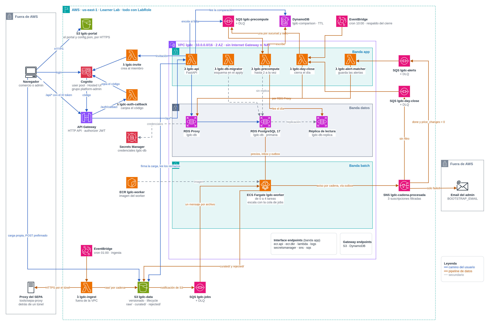

# Arquitectura de LGDC (TP3 y TP4)

Hacia dónde va la plataforma en las dos últimas entregas. El alcance de cada entrega está en [ADR-0001](adr/0001-alcance-tp3-tp4.md) y las convenciones de código en [terraform.md](terraform.md). Lo marcado **(TP4)** no entra en el TP3. Cómo se despliega y qué hace cada módulo de Terraform está en el [README](../README.md).

Región `us-east-1`, cuenta del Learner Lab, todo con el rol `LabRole`.

## Diagrama

Lo que crea el Terraform de [`infra/`](../infra/) en el TP3. Todo corre con el rol `LabRole`: no se crea ningún rol de IAM.



La fuente es [`arquitectura-tp3.drawio`](arquitectura-tp3.drawio), que se edita en [draw.io](https://app.diagrams.net). Después de cambiarla, se vuelve a exportar el PNG:

```sh
docker run --rm -v "$PWD/docs":/data -w /data rlespinasse/drawio-desktop-headless:v1.44.0 \
  -x -f png -s 2 -b 20 -o arquitectura-tp3.png arquitectura-tp3.drawio
```

### Dónde quedan los datos en S3

| Prefijo | Qué hay | Quién lo escribe |
|---|---|---|
| `raw/feed_date=<día>/chain_id=<cadena>/` | El archivo original de cada cadena, sin tocar | La ingesta |
| `raw/uploads/<upload_id>/` | La lista de precios que sube un comercio fuera del SEPA. Su llegada crea el job, como la de una cadena | El navegador, con un POST que firma la API |
| `curated/` | Los precios validados, en Parquet | Los workers |
| `rejected/` | Las filas descartadas (`rejected.jsonl`, con línea y motivo) y la copia de cada archivo que no se pudo cargar; los de una carga, en `rejected/uploads/<upload_id>/`, donde los lee la API | Los workers |

## Resumen

- **Cómputo.** Solo los workers corren en Fargate, dentro de una VPC sin salida a internet. Todo lo demás es Lambda: la API (el monolito FastAPI, detrás de API Gateway), la ingesta, el cierre del día, el precálculo, el callback de Cognito, la invitación de miembros, el migrador de esquema y el alert-matcher.
- **Jobs.** S3 → SQS. La ingesta solo sube archivos; el SEPA y la carga manual de un comercio siguen el mismo camino. La idempotencia es un inbox en Postgres, en la misma transacción que la carga.
- **Eventos.** Cada cadena procesada se publica, vía outbox, en el topic SNS `cadena-procesada`, que la reparte a tres destinos: la SQS de alertas, la SQS de cierre y el email del admin (solo los fallos).
- **Precálculo.** Cuando termina la última cadena del día, la comparación de cada sucursal seguida se calcula una vez contra la réplica y se guarda en DynamoDB, ya ordenada. El tablero pasa de cruzar más de un millón de filas a leer 20 items.
- **Datos.** RDS PostgreSQL es la fuente de verdad. El Parquet de `curated/` en S3 guarda el histórico. **(TP4)** Glue arma los agregados y Redshift los sirve a dos pantallas de analítica.
- **Auth.** Cognito con registro abierto, el callback por Lambda y un grupo `platform-admin`. El dueño invita a sus miembros: Cognito les manda una contraseña temporal.
- **Entrega.** Terraform en `infra/` y los workflows del repo de referencia `2026Q1-G1`. La cátedra carga los secrets y corre Deploy.

## Flujos

### Usuario

1. El navegador baja el portal de S3 por HTTPS.
2. Hace login o se registra en la Hosted UI de Cognito.
3. Cognito redirige a `/auth/callback`; la Lambda canjea el código (el client secret vive solo en ella) y devuelve los tokens al portal.
4. El portal llama a `/api/*`. API Gateway valida el JWT y la Lambda API consulta Postgres por RDS Proxy.
5. Para cargar un CSV, el navegador sube directo a S3 con un POST prefirmado, a `raw/uploads/<upload_id>/`. La API solo firma: la notificación de S3 genera el job, como para una cadena, y el worker lo vincula a la carga.
6. Tablero y Mis Precios leen la comparación precalculada de DynamoDB, por el gateway endpoint. Si todavía no está, la API usa la consulta en vivo.
7. Para invitar a un miembro, la API guarda su fila en Postgres e invoca, por el interface endpoint de Lambda, la Lambda de invitación, que corre fuera de la VPC y crea el usuario en Cognito ([ADR-0003](adr/0003-invitacion-por-lambda-fuera-de-la-vpc.md)). Cognito le manda la contraseña temporal y la Hosted UI le pide una nueva en el primer login.

### Datos

1. Un cron de EventBridge (o, a pedido, el workflow run-ingest) invoca la Lambda de ingesta. Corre fuera de la VPC: sale directo a internet y baja el ZIP del SEPA por el túnel al proxy, sin NAT. El SEPA bloquea las IPs de AWS, por eso el proxy (`tools/sepa-proxy/`) corre fuera de AWS.
2. La ingesta sube un archivo por cadena a `raw/`. Cada archivo nuevo dispara, por S3 Event Notifications, un mensaje directo a la SQS de jobs.
3. Los workers (de 0 a N según la cola) cargan Postgres y escriben `curated/`. Un archivo roto va a `rejected/` sin reintento; un error transitorio se reintenta y, al tercer fallo, el mensaje pasa a la DLQ.
4. En la misma transacción que la carga, el worker guarda los precios, los cambios de precio contra el día anterior (`price_change`), el registro del inbox y el evento en el outbox. Después del commit publica el evento en SNS y lo marca como enviado.
5. SNS aplica la filter policy de cada suscripción: la SQS de alertas recibe el evento solo si `status = done` y `price_changes > 0`; la SQS de cierre, siempre; el email del admin, solo si `status = failed`.
6. La Lambda alert-matcher cruza los cambios de esa cadena con las reglas de cada comercio y guarda las alertas.
7. La Lambda cierre marca la cadena como terminada y, si era la última del día, cierra el día y dispara el precálculo.
8. La Lambda precálculo corre la comparación contra la réplica y la escribe en DynamoDB.

Cada consumidor reintenta por su cuenta y, después de 3 intentos, pasa el mensaje a su DLQ.

El evento de `cadena-procesada` no lleva precios: es un aviso por cadena (15–20 por día, más uno por carga manual).

```json
{
  "feed_date": "2026-10-12",
  "company_id": 10,
  "kind": "sepa",
  "status": "done",
  "price_changes": 4213
}
```

## Precálculo

Tablero y Mis Precios corrían `COMPARISON_BASE` (hoy en `app/shared/comparison.py`) en cada request: ~8.000 productos del surtido propio contra 621 vecinos en 5 km son más de un millón de filas cruzadas para mostrar 20. El resultado no cambia hasta la ingesta del día siguiente, así que se calcula una vez por día y por sucursal seguida.

1. **Fin de cadena.** Cada worker publica su evento en `cadena-procesada`. La suscripción de cierre lo copia a la SQS de cierre sin filtro de estado: al cierre le importan tanto las cadenas que terminaron bien como las que fallaron.
2. **¿Es la última?** La Lambda cierre marca la cadena en `feed_day_chain` y hace `UPDATE feed_day SET closed_at = now() WHERE closed_at IS NULL` y no quedan jobs pendientes de ese día: cada cadena con archivo en `raw/` para ese día tiene su job en `done` o `failed` ([ADR-0004](adr/0004-cierre-del-dia.md)). Solo una invocación gana ese `UPDATE`; las demás terminan sin hacer nada. Una carga manual (`kind = upload`) no espera al día: encola solo la sucursal de ese comercio.
3. **Cierre.** La invocación que gana corre `refresh_neighbors` y `normalize_catalog` una sola vez, lee `org_branch` y encola en la SQS de precálculo un mensaje por cada combinación de sucursal seguida y radio. **(TP4)** También arranca el job de Glue.
4. **Precálculo.** La Lambda precálculo corre la misma consulta que la API en vivo (`comparison.dashboard`) contra la réplica, sin `LIMIT` y ordenada por peor brecha, una entrada por invocación. Antes de leer espera a que la réplica haya aplicado lo que la primaria tenía confirmado. Escribe el día como una generación nueva: las filas con `BatchWriteItem`, después el resumen y al final el item `META` con la fecha y la generación nuevas: hasta ese momento la API sigue mostrando la escritura anterior completa, también si es el mismo día escrito otra vez ([ADR-0005](adr/0005-precalculo-por-generaciones.md)). `META` solo avanza y no vence: una entrada de un día más viejo que el de `META` no calcula nada, y la escritura de `META` es condicional. Limitada a 2 invocaciones con `maximum_concurrency` en el event source mapping de SQS para cuidar la réplica (el Learner Lab no deja reservar concurrencia); con eso se conecta directo, sin el Proxy. Es idempotente: reescribe las mismas claves.
5. **Lectura.** La API hace un `GetItem` de `META`, que trae el resumen, y un `Query` de las filas de su generación con `Limit`. Mis Precios pagina con un cursor opaco que guarda el día, la generación y el ranking de la última fila, y reemplaza la paginación por offset. Cada respuesta dice de dónde salió (`source`: `precomputed` o `live`).
6. **Lo que no está precalculado.** Si alguien sigue una sucursal nueva (no hay `META`), la API responde con la consulta en vivo y encola el precálculo de su radio configurado, a lo sumo una vez cada 5 minutos. Otro radio u otro día también se responden en vivo, pero no se encolan: el radio sigue siendo libre, y solo el radio configurado de cada sucursal sale de DynamoDB ([ADR-0005](adr/0005-precalculo-por-generaciones.md)). Sin `feed_date`, la respuesta en vivo es del día de `META`, si lo hay.
7. **Respaldo.** Si una cadena termina en la DLQ, nunca llega su fin de cadena. Un cron a las 10:00 invoca la Lambda cierre con la fecha del día y cierra con lo que haya. Si después llega el aviso de una cadena que el día no tenía, el día se reabre y se vuelve a cerrar en el acto, con ella ([ADR-0004](adr/0004-cierre-del-dia.md)).

### La tabla `lgdc-comparison`

DynamoDB es solo una capa de lectura: un dato derivado que se puede regenerar desde Postgres. Una partición por sucursal seguida y radio; las filas llevan el ranking ya calculado, así que el orden del sort key es el orden de la pantalla.

```
PK  CMP#<company>:<banner>:<branch>#<radio_km>
SK  META                         qué día y qué generación están completos, con el resumen · sin TTL
    SUM#<feed_date>              resumen de posición del día · TTL 400 días (alimenta Tendencias)
    ROW#<feed_date>#<gen>#R00001 filas de una escritura, en orden «peor brecha primero» · TTL 7 días
    ROW#<feed_date>#<gen>#R00002
    …
    QUEUED                       la API encoló su precálculo · TTL 5 minutos
```

`META` no vence, para saber siempre cuál es el día más nuevo, pero guarda hasta cuándo duran las filas de su generación: si la ingesta se corta una semana, la API vuelve a la consulta en vivo en lugar de mostrar un día sin filas ([ADR-0005](adr/0005-precalculo-por-generaciones.md)).

| Necesidad | Operación |
| --- | --- |
| Tablero: resumen y peores 20 | `GetItem META` (trae el resumen) y `Query` de `ROW#<día>#<gen>#R00001` en adelante, con `Limit 20` |
| Mis Precios, paginado | El mismo `Query`, desde la fila siguiente a la del cursor |
| Mis Precios, filtro por texto | `FilterExpression contains(desc_norm, :q)` sobre las filas de la generación |
| **(TP4)** Posicionamiento histórico | `Query begins_with(SUM#)` entre dos fechas: un item por día |
| Sin `META` para esa sucursal o radio | Consulta en vivo en Postgres y precálculo encolado |

On-demand. Con 20 sucursales seguidas, ~160.000 escrituras por día (unos US$ 0,10) y ~0,3 GB almacenados.

## Decisiones

| Tema | Decisión | Por qué |
| --- | --- | --- |
| Base de datos | Postgres (RDS) como fuente de verdad, con 6 meses de precios (particiones mensuales que rota `pg_cron`), réplica y Proxy. DynamoDB solo para la comparación precalculada. **(TP4)** Redshift para la analítica, con Athena como plan B. | El producto es una comparación con radio libre, búsqueda y alertas que cruzan precios con reglas: un modelo relacional. La comparación del día es un resultado que se escribe una vez y se lee muchas, siempre por la misma clave. |
| Por qué DynamoDB y no una tabla en Postgres | La pantalla más usada deja de ocupar conexiones del Proxy y de cargar la réplica mientras se replica el `COPY`. El TTL borra los días viejos sin `DELETE` ni `VACUUM`, y la paginación por cursor viene incluida. | El costo es un segundo motor; se acota a una tabla, sin datos propios, escrita por una sola Lambda. |
| Lambda o contenedores | Lambda: API, auth-callback, invitación, migrador, ingesta, cierre, precálculo y alert-matcher. Fargate: solo los workers. | Bajar 330 MB por el túnel tarda 2–5 minutos y Lambda da 15 minutos y 10 GB de disco. Cada cadena son millones de filas, varios GB de RAM y un `COPY` de minutos: en Lambda habría que partir el archivo. |
| Disparo de jobs | S3 Event Notifications → SQS, directo. EventBridge solo para los crons. | El evento tiene un solo consumidor; S3 versionado ya permite reprocesar, y SQS con DLQ, reintentar. |
| Idempotencia | Inbox en Postgres (`processed_message`, clave `key#versionId`) con `INSERT … ON CONFLICT DO NOTHING`, en la misma transacción que la carga. | O se registran los precios y el mensaje juntos, o ninguno. |
| Outbox | El evento para SNS se guarda en `outbox` en la misma transacción que la carga; después del commit se publica y se marca. | Sin outbox, si el commit sale bien y el publish falla, nadie recibe alertas y el día no se cierra. |
| SNS | Topic `cadena-procesada` con tres suscripciones filtradas (alertas, cierre, email). **(TP4)** Topic `alertas-comercios`, una suscripción por usuario. | Fan-out: sumar el cierre del día fue agregar una suscripción, sin tocar el worker. |
| Roles | El grupo de Cognito `platform-admin` es el súper admin: el único que usa `/admin/*`, y lo da de alta Deploy con los secrets `BOOTSTRAP_*`. `owner` y `member` siguen siendo roles dentro de cada comercio, en Postgres; el `owner` invita a los `member`. | Separa el rol de plataforma del rol en el comercio. |
| Frontend | Endpoint HTTPS de S3, callback por Lambda, HashRouter. | Los tokens no viajan por HTTP. Es como lo hace el repo de referencia. |
| Red | VPC sin NAT ni Internet Gateway, tres bandas privadas (app, batch, datos) en 2 AZ. Gateway endpoints de S3 y DynamoDB. Interface endpoints de ECR (api y dkr), Lambda, Logs, SQS, SNS y Secrets Manager, con `for_each`. No hay endpoint de Cognito: no funciona con un user pool con dominio ([ADR-0003](adr/0003-invitacion-por-lambda-fuera-de-la-vpc.md)). **(TP4)** Firehose, Glue y Redshift Data. | Nada dentro de la VPC sale a internet. Lo que necesita una API externa (ingesta, ref-data) corre fuera de la VPC. |

## Terraform

```
lgdc-sepa/
├── infra/     versions.tf · providers.tf · backend.tf · variables.tf · locals.tf · data.tf · main.tf · outputs.tf
│   │          security_groups.tf · notifications.tf · migration.tf
│   └── modules/   network · data_lake · database · queue · topic · lambda_function
│                  batch · api · auth · frontend · serving
│                  observability (TP4) · analytics (TP4)
├── app/       shared · api · auth_callback · invite · db_migrator · frontend
│   └── batch/     ingest · worker · alert_matcher · day_close · precompute
├── tools/     sepa-proxy · verify (make verify)
├── docs/ · scripts/ · Makefile
└── .github/workflows/   validate · plan · deploy · destroy · run-ingest
```

| Módulo | Qué crea |
| --- | --- |
| `network` | VPC (con `terraform-aws-modules/vpc`), subredes, endpoints y security groups |
| `data_lake` | Versionado, lifecycle, política y CORS (la carga desde el portal) del bucket de datos, que crea la CLI ([ADR-0002](adr/0002-bucket-de-datos-fuera-de-terraform.md)); su notificación a SQS está en la composición |
| `database` | RDS PostgreSQL, réplica (`count`), RDS Proxy y el secreto en Secrets Manager |
| `queue` | Una SQS con su DLQ. Se usa 4 veces: jobs, alertas, cierre, precálculo |
| `topic` | Un topic SNS con sus suscripciones y filter policies (`for_each`) |
| `lambda_function` | Una Lambda con su log group y sus disparadores. Se usa 8 veces: API, callback, invitación, migrador, ingesta, cierre, precálculo, alert-matcher |
| `batch` | ECR, cluster y servicio de Fargate de los workers, con autoscaling por la cola |
| `api` | HTTP API de API Gateway con el authorizer JWT |
| `auth` | User pool, client, dominio, el email de invitación y el grupo `platform-admin` de Cognito |
| `frontend` | Public access block y política del bucket del portal, que crea la CLI como el de datos, y el `config.json` que lee el portal |
| `serving` | La tabla `lgdc-comparison` con TTL |

## TP4: analítica

`curated/` ya es un data lake: guarda todos los días los precios validados en Parquet. Con el historial se agregan dos pantallas.

**Tendencias** (comercio, por sucursal seguida): posicionamiento histórico (de los items `SUM#` de DynamoDB), quién mueve primero, dispersión de precios en mi zona y promociones de la competencia.

**Observatorio** (`platform-admin`): índice de precios LGDC sobre una canasta fija, en pesos, en dólares (BCRA) y contra el IPC (INDEC); calidad del SEPA (filas rechazadas, cadenas que no publicaron); uso de la plataforma.

| Servicio | Qué hace |
| --- | --- |
| Glue Data Catalog + Crawler | Tablas sobre `curated/`, `analytics/`, `reference/`, `rejected/` y `events/`, particionadas por fecha |
| Glue job (Spark) | Diario, lo arranca la Lambda cierre. Escribe `fact_price_change`, `agg_dispersion`, `idx_canasta` y `promo_candidates` en `analytics/` |
| Redshift Serverless | Modelo estrella cargado con `COPY`; detalle e historial de más de 90 días por Spectrum. La API consulta con la Data API |
| Kinesis Data Firehose | Eventos de uso desde la Lambda API a `events/` en Parquet |
| Athena | Plan B si el Learner Lab no deja Redshift: usa el mismo catálogo |
| Lambda ref-data | Diaria, fuera de la VPC: dólar del BCRA e IPC del INDEC a `reference/` |

EMR no se usa: es el mismo Spark que Glue con un clúster que administrar.
